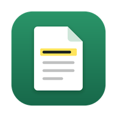
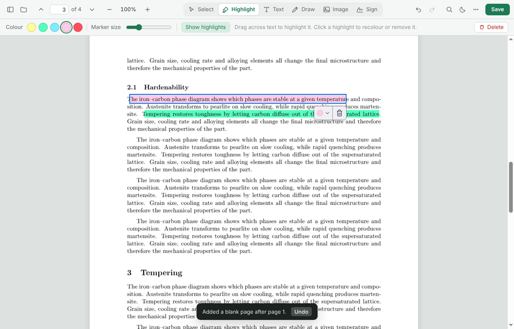
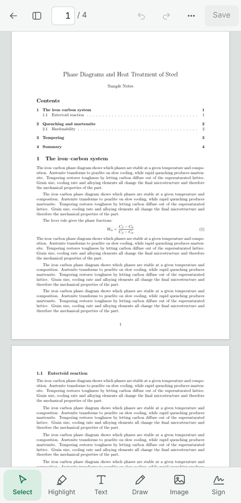
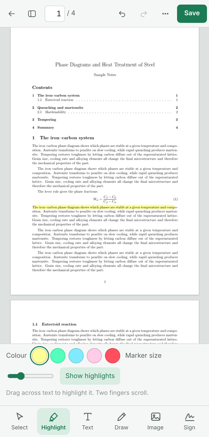

<p align="center">
  
</p>

<h1 align="center">Pata</h1>

<p align="center">
  A free PDF reader and annotator for <b>Windows, Mac and Android</b>.<br>
  Fast, smooth reading; highlight, write, draw, sign and add pictures; move pages around; merge PDFs and turn pictures into a PDF. No ads, no account, and your files never leave your device.
</p>

<p align="center">
  <a href="../../releases/latest"><b>⬇ Download Pata</b></a>
  &nbsp;·&nbsp; <a href="#install">How to install</a>
  &nbsp;·&nbsp; <a href="#বাংলায়">বাংলায় পড়ুন</a>
</p>

<p align="center">Developed by <b>Joy Sarkar &amp; Dhrubo Das</b></p>

---

<p align="center">
  
</p>
<p align="center">
  
  &nbsp;
  
</p>

## Download

Get the newest version from the **[Releases page](../../releases/latest)** and pick the file for your device:

| Your device | File |
|---|---|
| Android phone or tablet (Android 8 or newer) | `Pata-android.apk` |
| Windows 10 or 11 | `Pata-windows-x64.zip` |
| Mac with an Apple chip (M1, M2, M3, M4…) | `Pata-mac-arm64.zip` |
| Mac with an Intel chip | `Pata-mac-x64.zip` |

Not sure which Mac you have? Apple menu → **About This Mac**: "Chip: Apple M…" means Apple chip, "Processor: Intel…" means Intel.

## What it does

- **Reading:** smooth scrolling and pinch-to-zoom (also on a slow phone), page thumbnails, table of contents, find, fit to width or page, night and sepia page colours, presentation mode, and "Continue reading" where you left off
- **Marking up:** highlighter in five colours, text notes, pen drawing, pictures, and your own signature drawn with a finger or mouse; Undo and Redo always in reach
- **Pages:** drag thumbnails to reorder pages, add blank pages or pages from another PDF, rotate, and **add space beside a page** (left, right or both) for your own notes
- **Merge and convert:** **merge several PDFs** into one, or turn **photos and images into a PDF** (choose the order, page size, margin and "smaller file"); phone photos that were taken sideways come out upright
- **Many PDFs at once:** each opens as a tab in the same window (native tabs on a Mac)
- **Safe saving:** Auto-save can be turned on or off; asks before leaving changes behind; opens password-protected PDFs
- **On Android:** opens PDFs from any app ("Open with" or "Share" → Pata), print and share, back button that does what you expect; the app never asks for access to all of your storage

Pata is built on Mozilla's [PDF.js](https://github.com/mozilla/pdf.js) (drawing pages and editing marks) and [pdf-lib](https://github.com/Hopding/pdf-lib) (page changes). Everything it does with your PDFs happens on your own device.

## Install

### Android
1. Download `Pata-android.apk` on your phone and open it.
2. If asked, allow your browser or Files app to **install unknown apps**.
3. If Play Protect warns you, tap **More details → Install anyway**. It shows this for every app that is not from the Play Store.
4. To update later, install the newer `.apk` over the old one. Your recent files and settings stay.

### Windows
1. Right-click `Pata-windows-x64.zip` → **Extract All**.
2. Open the `Pata` folder and run **Pata.exe**. There is no installer: the folder is the app.
3. If Windows says "Windows protected your PC", click **More info → Run anyway**.

### Mac
1. Double-click the `.zip` and drag **Pata.app** into **Applications**.
2. Open Pata. The first time, macOS blocks it because it is not from the App Store: open **System Settings → Privacy & Security**, scroll down and click **Open Anyway**.
3. If macOS says the app "is damaged", open Terminal, run this once, then open Pata again:
   ```bash
   xattr -cr /Applications/Pata.app
   ```

## Good to know

- **Add space beside a page** changes the page size inside the PDF itself, so other PDF readers show the extra space too. **Remove added space** undoes it.
- **Windows and Mac:** the app is not code-signed (that costs money each year), so the first-run warnings above are expected.
- To update the Android app, install the newer `.apk` over the old one. Every release here is signed with the same key, so your files and settings stay.

## বাংলায়

**Pata (পাতা)** একটা ফ্রি, বিজ্ঞাপনহীন PDF reader: Windows, Mac আর Android ফোনে চলে। দ্রুত scroll আর মসৃণ zoom, highlight, লেখা, আঁকা, সই, ছবি বসানো, পাতা সাজানো, আর পাতার পাশে নোট লেখার জায়গা বাড়ানো যায়। একাধিক PDF জোড়া লাগিয়ে একটা করা (Merge) আর ছবি থেকে PDF বানানোও যায়। কোনো account লাগে না, আপনার ফাইল ডিভাইসের বাইরে যায় না।

**নামাতে:** উপরের [Releases page](../../releases/latest)-এ যাও। Android ফোনে `Pata-android.apk`, Windows-এ `Pata-windows-x64.zip`, নতুন Mac-এ `Pata-mac-arm64.zip` নাও।

**Android-এ install:** APK খুলে Install চাপো। "Install unknown apps" চাইলে অনুমতি দাও, Play Protect সতর্ক করলে **More details → Install anyway**। নতুন version এলে পুরোনোটার ওপরেই install করো, ফাইল আর settings থেকে যাবে।

**Windows-এ:** zip-এ right-click → Extract All, তারপর `Pata` ফোল্ডারের **Pata.exe** চালাও। "Windows protected your PC" দেখালে **More info → Run anyway**।

**Mac-এ:** zip খুলে **Pata.app** Applications-এ রাখো। প্রথমবার আটকালে **System Settings → Privacy & Security → Open Anyway**।

Developed by **Joy Sarkar & Dhrubo Das**.

## About

Pata is made by **Joy Sarkar and Dhrubo Das**. The source code is not published here; this page is only for downloading the app.

## License

[MIT](LICENSE), Copyright (c) 2026 Joy Sarkar and Dhrubo Das. Pata includes PDF.js (Apache License 2.0), pdf-lib (MIT) and Electron (MIT) under their own licenses, copied into each build's `LICENSES` folder.
